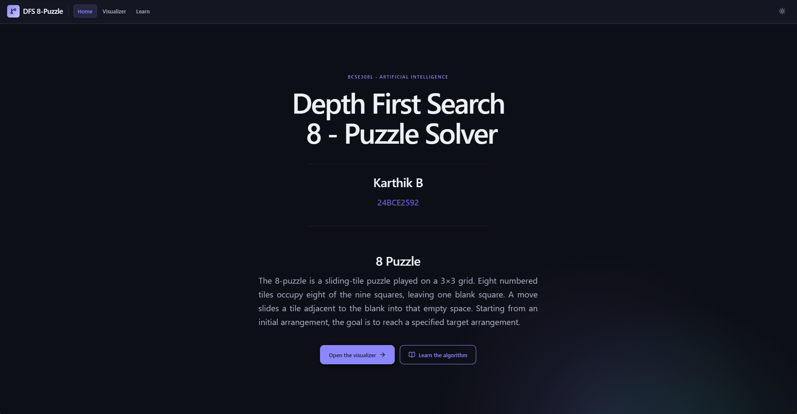
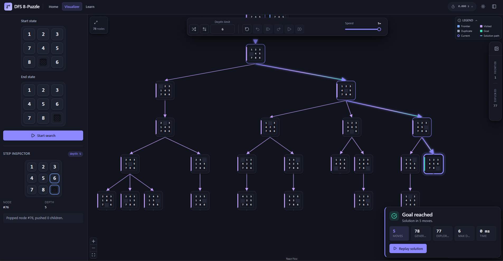
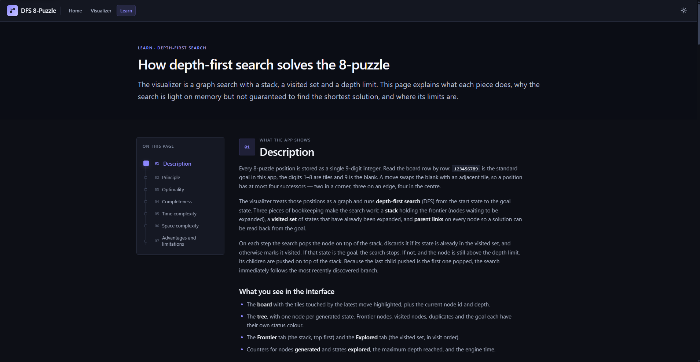

# DFS 8-Puzzle Visualizer

An interactive, animated visualization of **depth-first search** on the 8-puzzle. Step through the
search one node at a time, watch the full state-space tree grow, and compare the frontier with the
explored set.

## Technologies Used  

Built with Vite, React 18, TypeScript, React Flow (`@xyflow/react`), Zustand and Framer Motion.

## Search Algorithm

Implemented Depth First Search, limited to a maximum depth of 30 for time and memory constraints (DOM nodes)

## Screenshots

- Home page



- Visualizer Page



- Learning Page



## GitHub URL

[GitHub Pages URL](https://localhost:1234)

## Student Details

- Name : Karthik B
- Registration Number: 24BCE2592

## How to Run

```bash
npm install
npm run dev        # http://localhost:5173
```

Production build and preview:

```bash
npm run build
npm run preview
```

## What you can do

- **Edit both boards.** Click one tile, then another, to swap them. The blank (9) is a tile too;
  `Esc` cancels a selection. The goal board is fully editable.
- **Start a search.** Board edits are staged — press **Start search** to configure and reset the
  engine. Unsolvable start/goal pairs are blocked with an inline explanation.
- **Step, undo, redo, reset, auto-play and run to end.** Every action produces a new immutable
  snapshot; undo restores the previous snapshot exactly and redo replays the step.
- **Watch the tree.** New children animate in, backtracking pulses up the edges, undo fades removed
  nodes out, and the solution path glows in sequence. Every generated node stays visible until it is
  removed; the status bar on each square node matches the legend colour.
- **Inspect the search.** The step inspector shows the current board, node id, depth, and a one-line
  narration of what the engine just did.
- **Browse the frontier and explored set.** The floating search-list deck is virtualized, searchable
  by node id, and linked to the tree (hover highlights, click pans).
- **Replay a solution.** The result card reports moves, generated/explored nodes, maximum depth and
  execution time, and can animate the solution on a board.
- **Learn the algorithm.** The Learn page explains the principle, optimality, completeness,
  complexity and trade-offs, with pseudocode and diagrams.

Keyboard shortcuts: `Space` step, `←` undo, `→` redo, `A` auto-play, `R` reset, `[` toggle the search-list deck.

## Project layout

```
src/
├─ contract/        Frozen types, store interface, shared UI props, fixtures
├─ engine/          Pure TypeScript: codec, moves, solvability, DFS, metrics
├─ store/           Zustand stores: search, settings, tree view
├─ components/      layout · controls · board · tree · info · sidebar · learn
├─ hooks/           autoplay/hotkeys/layout/camera/replay/reduced-motion
├─ routes/          HomePage, VisualizerPage, LearnPage
├─ styles/          tokens.css + global.css (+ CSS modules)
└─ utils/           formatting and direction helpers
```

The engine is deliberately framework-free. A search is a mutable controller that returns a
`SearchSnapshot` after each action; the store simply publishes that snapshot to React. The stack is
an array (top = last element), the visited set is a `Set` mirrored as an ordered array in snapshots,
and every node keeps a parent id so the path and the tree can be reconstructed.
